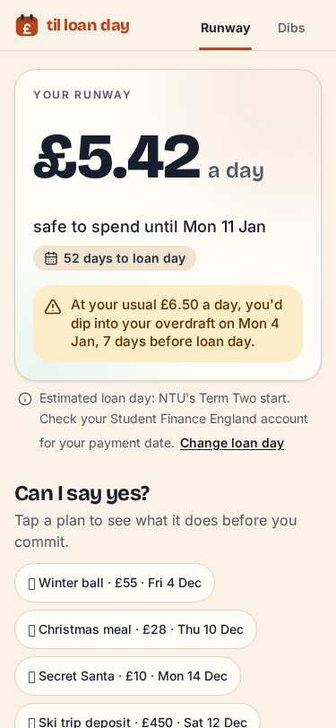
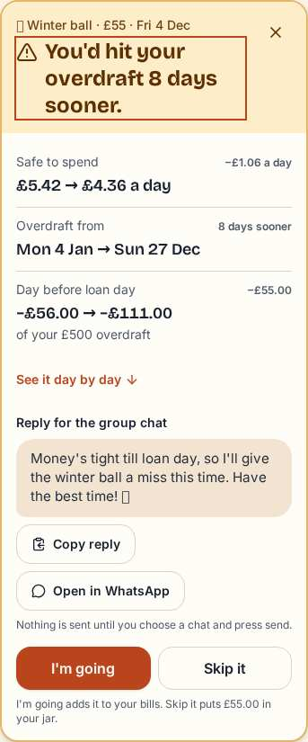
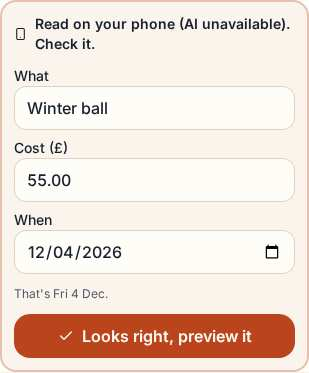
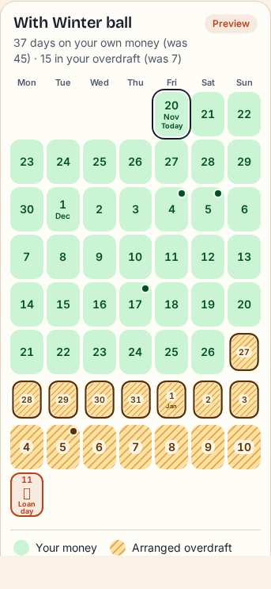
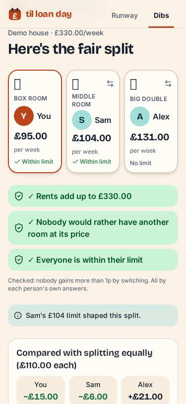
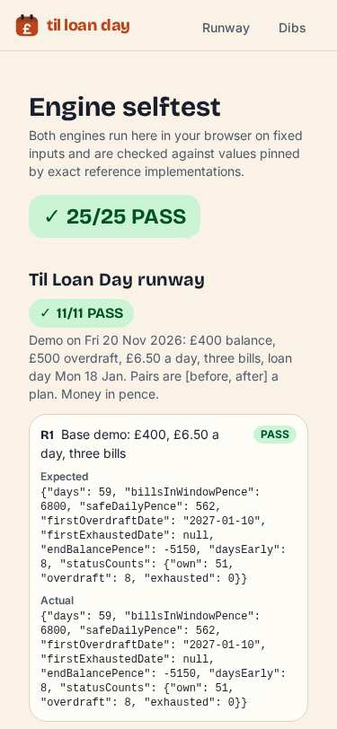

# Accessibility and mobile audit

**20 November 2026 · Til Loan Day rebuild `2a124c3` · Chromium · 375 × 812 and 1280 × 900**

Audited local Vite at `http://localhost:8080`: Runway (`/`), Dibs (`/dibs`) and
`/selftest`. The rebuilt routes load, all requested keyboard flows complete, and selftest
reports **25/25 PASS**. A passing suite is **not an accessibility all-clear**: axe is an
inventory, and the findings below include problems in states beyond the initial route.

## Scope and method

From the repo root, installed and restarted the rebuilt app:

```sh
bun install && bun run dev -- --port 8080
```

From `e2e/`, with Node activated (`source /home/ubuntu/.nvm/nvm.sh` in this environment):

```sh
npm ci
npx playwright install chromium
npx playwright test --list
BASE_URL=http://localhost:8080 npx playwright test --workers=2
```

Observed installation: `added 5 packages`, `found 0 vulnerabilities`; Chromium installed.
Discovery: `Total: 12 tests in 2 files`. Final local suite output:

```text
12 passed (14.9s)
```

| Target            |            Passed | Failed | Skipped |
| ----------------- | ----------------: | -----: | ------: |
| Local rebuild     |                12 |      0 |       0 |
| Published rebuild | Pending republish |      — |       — |

The suite uses Tab and Enter/Space, never mouse clicks, for:

- Runway: Winter ball chip → preview → Skip it.
- Invite: Try an example → Read it → Looks right, preview it → preview within 12s.
  **The local run hit the on-device fallback**, not a successful AI response.
- Dibs: Start → Lock in → reveal → Preview £95.00 in Til Loan Day → Runway preview.

Each route audit records HTTP status, console/page errors, document width, axe violations,
and initial-state Tab reachability/computed focus-ring changes. Additional browser probes
scanned expanded Your numbers, the invite draft, the Runway preview and the Dibs reveal.
Settled scans waited for finite animations; Dibs also waited for the flip timer and populated
rent accessible names. See [raw inventory](A11Y-V2-RAW.json) for rules, impacts, node counts,
selectors, example nodes, labels and focus observations. Repeated calendar labels and transient
animation scans have been trimmed from that file.

## Route measurements

Counts below are **axe violation rules per initial-route scan**, not affected elements.
Both viewports had the same results. All documents fit their viewport (375/375 and
1280/1280 CSS px). No browser errors were recorded.

| Route        | HTTP | Critical | Serious | Moderate | Minor | Initial controls checked, each viewport |
| ------------ | ---: | -------: | ------: | -------: | ----: | --------------------------------------: |
| `/` Runway   |  200 |        0 |       0 |        0 |     0 |                                      16 |
| `/dibs` Dibs |  200 |        0 |       0 |        0 |     0 |                                      10 |
| `/selftest`  |  200 |        0 |       0 |        0 |     0 |                                       5 |

Every inventoried visible, enabled control was reached by Tab and showed a changed computed
outline or box shadow. This does not establish indicator contrast, clipping or visibility
under the sticky header. Flow tests annotate observed Dibs focus loss and preview-list findings
rather than hiding them behind a passing functional result.

## Findings

| Surface                | Impact / evidence                                                                                                                                                                                                                             | Source                                                                                                                                                                                                               |
| ---------------------- | --------------------------------------------------------------------------------------------------------------------------------------------------------------------------------------------------------------------------------------------- | -------------------------------------------------------------------------------------------------------------------------------------------------------------------------------------------------------------------- |
| Dibs screen changes    | **Keyboard/screen-reader orientation issue:** focus becomes `<body>` after both Start and Lock in, at both sizes. No populated live region announces the new screen. Tab can still reach the next action.                                     | `src/components/dibs/DibsApp.tsx:33–36` (`go`)                                                                                                                                                                       |
| Runway preview metrics | **Serious:** axe `definition-list` (1 node, `dl`) and `dlitem` (6 nodes, e.g. `dl > div > div > dt`) at both sizes, including after animation settles. Extra nested wrappers break the permitted `dl`/`dt`/`dd` structure.                    | `src/components/money/PlanPreviewCard.tsx:128–145`                                                                                                                                                                   |
| Dibs reveal cards      | **Serious axe finding, naming review required:** `label-content-name-mismatch` on all 3 room buttons at both sizes; persists after reveal settles. Example: `.flip-card:nth-child(1) > .flip-inner.is-flipped`.                               | `src/components/dibs/RevealScreen.tsx:118–187`, especially accessible names at `123–126`                                                                                                                             |
| Preview announcement   | **Enhancement / assistive-technology verification needed, not a demonstrated WCAG failure:** verdict has no dedicated live summary. Focus does move to `#preview-heading` (verified in all three flows); actual spoken output was not tested. | `src/components/money/PlanPreviewCard.tsx:68–73,104–111`; `src/components/money/SayYes.tsx`                                                                                                                          |
| Contrast inventory     | **Unresolved manual checks, not confirmed contrast failures:** axe cannot resolve some gradients, pseudo-elements, transformed cards and short text. See counts below.                                                                        | `src/components/money/DayCalendar.tsx:180–189`, `src/components/money/styles.ts:9–22`, `src/components/shell/AppShell.tsx:12–30,65–95`, `src/components/dibs/RevealScreen.tsx:128–187`, `src/routes/selftest.tsx:56` |

### Contrast follow-up

No settled-state `color-contrast` violations were found. Incomplete contrast **node counts**
are listed below; these are not pass/fail counts. The raw JSON retains example selectors
and axe's explanation for each group.

| State                                               | Mobile incomplete nodes | Desktop incomplete nodes |
| --------------------------------------------------- | ----------------------: | -----------------------: |
| Runway initial                                      |                       9 |                        9 |
| Dibs initial                                        |                       1 |                        2 |
| Selftest initial                                    |                       3 |                        3 |
| Settled Runway chip preview + Your numbers expanded |                      17 |                       19 |
| Settled Dibs reveal                                 |                      20 |                       21 |

An immediate preview scan reported 22 contrast nodes during its entrance animation. A
follow-up after animations completed removed that contrast violation; do not interpret it
as a settled palette failure. Hatched calendar backgrounds and nav pseudo-elements still
need manual contrast measurement. Focus-indicator contrast was not measured.

### Semantics, labels and announcements

- **Landmarks/headings:** `src/components/shell/AppShell.tsx:35–129` supplies a skip link,
  banner, named Tools navigation, `main#main` and footer. Initial H1s are Your runway,
  Who gets the big room?, and Engine selftest. No landmark/heading axe violations were found.
- **Calendar is not color-only:** `DayCalendar.tsx:162–164` gives each day `role="img"`
  and an accessible date/balance/status label. `src/components/money/copy.ts:144–160`
  maps own money, overdraft and exhausted states to text, adding bills, Today and plan changes.
  Observed example: “Mon 4 Jan: −£2.00, in your overdraft”. Hatching, a legend and exhausted
  crosses supplement color. The exhausted label mapping was inspected in code, not exercised
  in the screenshot scenario.
- **Paste box:** `src/components/money/InviteReader.tsx:135–147,196–242` associates Group
  chat message with the textarea and wraps draft inputs in What, Cost (£), When labels.
  The draft source uses `role="status"`; the local text was “Read on your phone (AI
  unavailable). Check it.” Its actual announcement in a screen reader remains untested.
- **Your numbers:** `src/components/money/YourNumbers.tsx:43–91,190–254,416–464` exposes
  expanded/controls state and labelled balance, overdraft, spend, date and bill fields.
  `src/components/money/fields.tsx:40–76` associates visible labels, hints/errors via
  `aria-describedby`, and `aria-invalid` on errors. No unlabelled fields were found in the
  expanded inventory; validation error interactions were not comprehensively exercised.
- **Preview/actions:** the preview is a named article; its H3 receives focus. Copy success
  has a polite region (`PlanPreviewCard.tsx:211–213`), and added/skipped notices use
  `role="status"` in `SayYes.tsx`. Closing the preview focuses the Can I say yes? heading
  (`src/components/money/RunwayPage.tsx:99–102`).

## Suggested app changes for Claude

Top five, in priority order. These are app-side suggestions; this branch changes only tests
and documentation.

1. **Restore Dibs focus after screen changes.** In
   `src/components/dibs/DibsApp.tsx:33–36`, focus the newly rendered screen's H1 after
   React commits, using a heading ref and `tabIndex={-1}` (or a screen wrapper/ref lookup).
   Apply to Start, Lock in, Edit and restart transitions; retain the privacy screen's
   deliberate ready-control focus. Verify meaningful reading order and scroll position.
2. **Repair preview definition-list structure.** In
   `src/components/money/PlanPreviewCard.tsx:128–145`, make each direct `dl > div` group
   contain its `dt` and `dd` directly. Move the visual flex layout to CSS/grid, or place
   value/change content together inside one `dd`. Re-run axe on the open preview: both
   `definition-list` and `dlitem` should disappear.
3. **Align reveal-card names with visible labels.** In
   `src/components/dibs/RevealScreen.tsx:118–187`, prefer `aria-labelledby` referencing
   the visible room/person/rent labels, with extra comparison instructions in
   `aria-describedby`. Hide decorative avatar initials and the inactive flip face from
   assistive technology as appropriate. Check the exact rendered accessible names before
   and after the flip, then re-run `label-content-name-mismatch` on all three cards.
4. **Consider a dedicated preview verdict announcement.** In
   `src/components/money/PlanPreviewCard.tsx` / `src/components/money/SayYes.tsx`, consider
   an already-mounted, visually hidden `role="status"` or polite `aria-live` summary updated
   with the verdict text. Keep the useful focus hand-off, but test with a screen reader to
   avoid announcing the same verdict twice. This is a recommendation, not a proven failure.
5. **Resolve manual contrast checks.** Measure text and focus rings against the actual
   hatched calendar pixels (`DayCalendar.tsx`, `money/styles.ts`) and nav pseudo-element
   backgrounds (`shell/AppShell.tsx`). Include Dibs transformed cards and selftest badges.
   If necessary, give text an opaque backing or adjust foreground/background tokens in
   `src/styles.css`; preserve the non-color status cues. Record ratios rather than treating
   axe's incomplete result as a pass.

## Published app

**Pending republish; no rebuilt-app published suite result yet.** The initial readiness
checks of [the published URL](https://dibs-fair-rooms.lovable.app) still returned
`Dibs: fair rooms, rents you can afford`. A later check during report preparation returned
**HTTP 404, title `Project not found`**, so the public target is currently unavailable rather
than verified as the rebuild. Do not transfer the local pass result to the published app.

The background title poll was started from `e2e/` with:

```sh
node wait-for-publish.mjs https://dibs-fair-rooms.lovable.app 2700
```

Once the HTML title contains Til Loan Day, run:

```sh
BASE_URL=https://dibs-fair-rooms.lovable.app npx playwright test --workers=2
```

Replace this pending section with the observed published result when available.

## Screenshots and untested scope

Fresh **local** mobile evidence, captured at a 375px viewport (element crops are narrower),
JPEG quality 55; every image was opened and checked for the intended state. Each is under
80KB. These are not published-app screenshots.

### Runway initial and chip preview





### Invite draft and calendar





### Dibs reveal and holding-deposit hand-off




### Selftest



Not tested: screen-reader speech, native mobile browsers, successful AI responses, clipboard
and WhatsApp delivery, exhaustive validation/error cases, Dibs pass-the-phone and challenge
flows, all preview verdicts, or every dynamic control's focus indicator. Some decorative emoji
render as missing-glyph boxes in this local Chromium environment; no cross-platform conclusion
was drawn. Manual contrast and focus-indicator visibility checks remain outstanding.

See [the suite README](../e2e/README.md) for setup, BASE_URL and trace/report commands.
